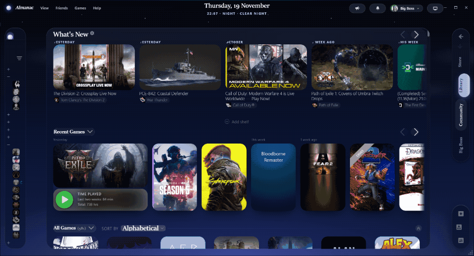
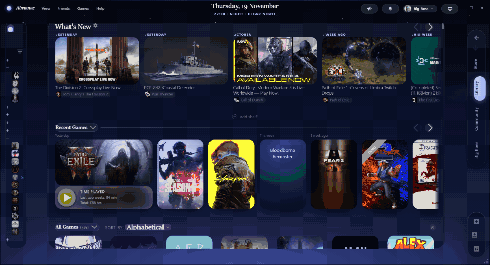

# Almanac

**A sky that follows your real clock.** A [Millennium](https://steambrew.app) theme for the Steam client.

- **Seven phases of the day:** night, daybreak, morning, midday, afternoon, dusk and evening. Each repaints the sky and tints every panel, accent and button, gliding from one phase to the next over a minute.
- **The sun and moon** travel across the window on an arc set by the time. Stars come out after dusk, and soft clouds drift by.
- **Weather:** seasonal snow from December to February, or always clear, rain or snow.
- **A magazine layout:**
  - A masthead dateline ("Thursday, 19 November · 05:48 · Daybreak · Clear").
  - The game list as a slim icon rail that opens over the page on hover.
  - The page as a centered reading column with open sky either side.
  - Store / Library / Community set vertically down the right edge, with the dock beneath.
- **Type:** Sitka (ships with Windows) for headlines, italics for play.
- **A greeting** for the time of day when Steam opens.

## Install

1. Install [Millennium](https://steambrew.app).
2. Find **Almanac** in the Millennium theme browser, or download this repository into `Steam/millennium/themes/Almanac`.
3. Open **Steam → Millennium → Themes** and pick **Almanac**.

## Options

Open **Millennium → Themes → Almanac** to change:

Weather · Sky (follow the clock / always day / always night) · Clouds · Corner radius · Glass tint · Density · What's New · Dock labels · Readout · Startup screen · Motion · Cover hover · Cursor light · Privacy

Everything here is original: no other game's names, logos, art or fonts. Fonts are ones that ship with Windows.

## License

MIT, see [LICENSE](LICENSE).
